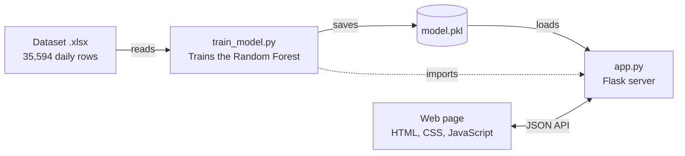

# Inventory Demand Planner

A web application that tells a store manager **how many units are left, how many will be demanded over the next week, and how many units to order**. It combines a Random Forest model trained on 35,594 daily electronics sales records with a Flask backend and a modern single-screen web interface.

> **Model accuracy:** R² = **0.927** and mean absolute error = **4.19 units/day** on the latest 90 days of unseen data (a simple "next week equals today" baseline has an error of 7.54 units/day).

---

## Table of Contents

1. [Project Overview](#1-project-overview)
2. [Dataset Overview](#2-dataset-overview)
3. [Data Preparation and Feature Engineering](#3-data-preparation-and-feature-engineering)
4. [Machine Learning Approach](#4-machine-learning-approach)
5. [System Architecture and Project Structure](#5-system-architecture-and-project-structure)
6. [Technologies Used](#6-technologies-used)
7. [Features](#7-features)
8. [Application Workflow](#8-application-workflow)
9. [Installation and Usage](#9-installation-and-usage)
10. [Scope, Limitations and Future Enhancements](#10-scope-limitations-and-future-enhancements)
11. [Conclusion](#11-conclusion)

---

## 1. Project Overview

### Background
Electronics retailers sell products with very different sales speeds. In the dataset, an accessory can sell about 119 units a day while a premium laptop sells fewer than 10. Ordering too little causes lost sales; ordering too much locks up money in unsold stock. Many small businesses still decide order quantities by intuition, which ignores seasonality and product type.

### Problem Statement
Given the current stock level and the units sold, a planner needs to answer three questions quickly and consistently:

1. How many units are still in stock?
2. How many units will customers demand per day over the coming week?
3. How many units should be ordered so the shelf stays covered, with a safety buffer?

### Objectives
- Build an accurate demand-forecasting model from historical electronics sales data.
- Reach a forecast accuracy above 90% (R²) on data the model has never seen.
- Convert the forecast into a clear reorder quantity using a transparent formula.
- Provide a fast, professional web interface that needs no technical knowledge.
- Keep the Python files and the web page tightly connected, so the same model serves every request.

---

## 2. Dataset Overview

The project uses one Excel file, `Electronics_Dataset.xlsx`, with **35,594 daily records** and **11 columns**, covering **1 January 2023 to 30 September 2026**. It has no missing values and no duplicate rows. Each row is one product on one day; the file tracks **26 products** (1,369 days each) in **13 product categories**.

| Column | Type | Description |
| --- | --- | --- |
| Date | Date | Day of the record (2023-01-01 to 2026-09-30) |
| Category | Text | Always "Electronics" (a single value) |
| Subcategory | Text | Product type, 13 values, used as the **Category** dropdown in the app |
| Product_ID | Text | Unique code of the product, e.g. `MOB001` (26 products) |
| Product_Name | Text | Name of the product, e.g. "Gaming Laptop" |
| Price | Number | Selling price that day (1,462.5 to 95,000) |
| Discount | Number | Discount in percent: 0, 5, 10, 15, 20 or 25 |
| Promotion | 0 / 1 | Whether a promotion ran that day (about 35% of days) |
| Inventory_Level | Number | Units in stock (0 to 1,767, average about 163) |
| Units_Sold | Number | Units sold that day (0 to 231, average about 32.6) |
| Demand | Number | Units demanded that day |

**Categories:** Accessories, Camera, Gaming Console, Headphones, Laptop, Mobile, Monitor, Printer, Router, Smartwatch, Speaker, Tablet, Television.

### Key observations
- **Demand equals sales.** `Demand` and `Units_Sold` are identical in every row. Predicting same-day demand from units sold would only copy the input, so the project forecasts *future* demand instead.
- **Sales speed varies a lot.** Accessories sell about 94 units/day on average and routers about 65, while cameras and televisions sell about 12.
- **Demand is seasonal.** Average daily demand peaks in March and April (about 36 units) and is lowest in September (about 27 units).
- **Stock-outs are rare but present.** In about 1.4% of rows, units sold exceed the inventory level, so the app validates and rejects such inputs.
- **No Region column.** The file has no regional information. The app offers a Region dropdown, but it affects the forecast only once a `Region` column is added to the dataset and the model is retrained.

---

## 3. Data Preparation and Feature Engineering

`train_model.py` prepares the raw data in five steps:

1. **Load and sort** by product and date, so each product forms a continuous daily series.
2. **Create the Category input.** `Subcategory` is copied into a `ProductType` feature, because the original `Category` column has only one value.
3. **Derive Seasonality from the date:** Winter (Dec–Feb), Summer (Mar–Jun), Monsoon (Jul–Sep), Festive (Oct–Nov).
4. **Calculate Remaining stock** = `Inventory_Level − Units_Sold`.
5. **Build the target:** the average `Demand` of the same product over the **next 7 days**. The last 7 days of each product have no future data and are dropped, leaving 35,412 training rows.

**Why a 7-day average?** Demand on a single day is mostly random (promotions, discounts, shopper behaviour). A 7-day average removes much of this noise, lets the model learn real patterns, and matches how stock is planned in practice. It raised R² from about 0.80 (next-day demand) to 0.93.

### Model inputs

| Input | Type | Source in the app |
| --- | --- | --- |
| Inventory_Level | Number | Inventory level field |
| Units_Sold | Number | Units sold field |
| Remaining | Number | Calculated automatically |
| ProductType | Category (one-hot) | Category dropdown |
| Season | Category (one-hot) | Seasonality dropdown |
| Region | Category (one-hot) | Region dropdown, used only if the dataset contains a Region column |

---

## 4. Machine Learning Approach

### Why Random Forest
A Random Forest averages many decision trees. It handles numbers and categories together, captures non-linear patterns such as seasonal peaks, needs little tuning and resists overfitting. The spread between its trees also gives a natural range for each forecast.

### Configuration

| Setting | Value |
| --- | --- |
| Algorithm | `RandomForestRegressor` (scikit-learn) |
| Number of trees | 100 |
| Minimum samples per leaf | 5 |
| Categorical encoding | One-hot encoding, unknown values ignored |
| Random seed | 42 |
| Saved file | `model.pkl` (joblib) |

### Evaluation method
The model is tested the way it is used: it learns from the past and is tested on the future. Data up to 97 days before the end is used for training, a 7-day gap prevents overlap, and the **final 90 days are used only for testing**. The final model is then retrained on all data.

### Results

| Metric | Random Forest | Baseline (next week = today) |
| --- | --- | --- |
| R² score | **0.927** | – |
| Mean absolute error | **4.19 units/day** | 7.54 units/day |

The average error is about 44% lower than the baseline. For each prediction the app also shows a **likely range**: the 10th to 90th percentile of the 100 tree predictions.

---

## 5. System Architecture and Project Structure



```text
inventory_planner/
├── app.py                    # Flask server: validation, API, page rendering
├── train_model.py            # Data preparation, training, evaluation, model.pkl
├── model.pkl                 # Saved model (created by train_model.py)
├── Electronics_Dataset.xlsx  # Historical sales data
├── requirements.txt          # Python packages
├── templates/
│   └── index.html            # Page structure
└── static/
    ├── style.css             # Styling, layout, animation
    └── script.js             # Tabs, validation, API calls, results, history
```

### How the files are linked
- `app.py` imports `train_model.py`. If `model.pkl` is missing, the server trains the model automatically at start-up.
- The dropdown lists (categories, regions, seasons) come from the saved model and are written into `index.html` by Flask, so the page always matches the model.
- `script.js` sends the form values as JSON to the API and shows the JSON answer on the page.
- Retraining after a dataset change updates the dropdowns and predictions without editing any page code.

### API endpoints

| Method and path | Purpose | Main response fields |
| --- | --- | --- |
| `GET /` | Serves the web page | HTML page |
| `POST /api/remaining` | Remaining stock | remaining, sell-through %, status |
| `POST /api/predict` | Demand forecast | demand per day, low/high range, days of cover, status |
| `POST /api/order` | Order recommendation | demand per day, safety units, target stock, order quantity |

Every endpoint validates its input and returns a clear error (HTTP 400) for invalid values, such as units sold greater than inventory or an unknown category.

---

## 6. Technologies Used

| Area | Technology | Used for |
| --- | --- | --- |
| Language | Python 3 | Data preparation, model training, web server |
| Data handling | pandas, NumPy | Reading data, building the 7-day target, forecast ranges |
| Excel input | openpyxl | Reading the `.xlsx` dataset |
| Machine learning | scikit-learn | RandomForestRegressor, OneHotEncoder, ColumnTransformer, Pipeline, R² and MAE |
| Model storage | joblib | Saving and loading `model.pkl` |
| Web framework | Flask with Jinja2 | Routes, JSON API, filling the dropdowns |
| Markup | HTML5 | Page structure, accessible tabs and form |
| Styling | CSS3 | Grid and flexbox layout, glass cards, gradients, animations, responsive design |
| Interactivity | JavaScript (no framework) | Tabs, validation, fetch calls, count-up animation, history |
| Graphics | Inline SVG | Icons and the warehouse illustration |
| Typography | IBM Plex Sans (Google Fonts) | Clean, professional text |

---

## 7. Features

### Functional features
- **Remaining inventory:** units left, sell-through percentage, and a healthy / low (under 20%) / out-of-stock status.
- **Demand prediction:** average daily demand for the next 7 days for the chosen category and season, with a likely range and the days the stock will last.
- **Order quantity:** recommended units to order from the forecast, days to cover and safety stock percentage, with a short explanation.
- **Category, Region and Seasonality dropdowns** filled from the dataset and model; the current season is selected automatically.
- **Live calculation** of remaining stock while typing.
- **Input validation** in both the browser and the server.
- **Smart status messages** such as "Your stock is sufficient!" or "Stock-out risk".
- **Calculation history:** click any row to reopen that calculation; one button clears the list.

### User interface features
- Single-screen layout without page scrolling on laptops and desktops; stacked layout on tablets and phones.
- Full-width tabs with icons, and form fields with icons.
- Result card that changes colour with the stock status (green, amber, red).
- Animated pastel background, fade-in cards, counting-number animation, button light sweep and a floating illustration.
- Keyboard-friendly tabs and support for the "reduce motion" setting.

---

## 8. Application Workflow

1. Start the server with `python app.py` and open the page in a browser.
2. Choose a tool: **Remaining inventory**, **Demand prediction** or **Order quantity**.
3. Enter the inventory level and units sold. The remaining stock appears at once.
4. For demand and order, select Category, Region and Seasonality. For an order, also set days to cover and safety stock %.
5. Press the action button. The browser checks the input and sends it to the matching API endpoint.
6. Flask validates the data again, asks the Random Forest for a forecast where needed, and returns the result.
7. The page shows the result card and adds a row to the history.

### Formulas

```math
\text{Remaining} = \text{Inventory level} - \text{Units sold}
```

```math
\text{Days of cover} = \frac{\text{Remaining}}{\text{Predicted demand per day}}
```

```math
\text{Order} = \left\lceil D \times N \times \left(1 + \frac{S}{100}\right) - \text{Remaining} \right\rceil
```

where *D* = predicted demand per day, *N* = days to cover, *S* = safety stock percentage (the order is never below zero).

### Worked example
120 Mobile units in stock, 45 sold in winter, cover 7 days with 20% safety stock:

| Step | Calculation | Result |
| --- | --- | --- |
| Remaining stock | 120 − 45 | 75 units |
| Predicted demand (model) | Random Forest forecast | about 24.1 units/day |
| Demand for 7 days | 24.1 × 7 | about 169 units |
| Safety stock | 20% of 169 | about 34 units |
| Target stock | 169 + 34 | about 203 units |
| **Order quantity** | 203 − 75 | **about 128 units** |

### Status rules

| Tool | Healthy | Low | Critical |
| --- | --- | --- | --- |
| Remaining inventory | 20% or more of inventory left | Under 20% left | Nothing left |
| Demand prediction | 7 or more days of cover | 3 to 7 days of cover | Under 3 days, or empty |
| Order quantity | No order needed | Order now | – |

---

## 9. Installation and Usage

```bash
# 1. Clone the repository
git clone https://github.com/<your-username>/<your-repo>.git
cd <your-repo>

# 2. (Optional) create a virtual environment
python -m venv venv
venv\Scripts\activate          # Windows
# source venv/bin/activate     # macOS / Linux

# 3. Install the packages
pip install -r requirements.txt

# 4. Train the model (optional: the server trains it automatically if model.pkl is missing)
python train_model.py

# 5. Start the web app
python app.py
```

Then open **http://127.0.0.1:5000** in your browser.

To use your own data, replace `Electronics_Dataset.xlsx` (keep the same column names, and optionally add a `Region` column) and run `python train_model.py` again.

---

## 10. Scope, Limitations and Future Enhancements

### Scope
**In scope:** forecasting average daily demand for the next 7 days for 13 electronics categories; calculating remaining stock and recommending order quantities with a safety buffer; a responsive web interface; retraining whenever the dataset is updated.

**Suitable users:** small and medium electronics retailers, store and warehouse managers, purchasing teams, and students learning how machine learning is applied to supply chain problems.

**Outside the current scope:** live billing / point-of-sale / warehouse integration; user accounts and permissions; multi-store transfers, supplier lead times and purchase-order generation.

### Limitations
- **Region has no effect yet,** because the dataset has no Region column.
- **Single-day inputs:** the form uses one day's inventory and sales; a longer sales history would give the model more information.
- **No price or promotion inputs:** they are in the dataset but not asked for in the form.
- **Category-level forecast:** the model predicts per product category, not per individual product.
- **Approximate seasonality:** seasons are derived from months, and one-off events are not modelled.
- **Temporary history:** the history lives in the browser tab and is cleared on reload.

### Future enhancements

| Enhancement | Benefit |
| --- | --- |
| Add a real Region column to the data | Region-specific forecasts |
| Add price, discount and promotion inputs | What-if scenarios such as a 20% discount |
| Forecast per product (`Product_ID`) | More precise orders per item |
| Supplier lead time and reorder point | Say *when* to order, not only how much |
| Compare models (Gradient Boosting, XGBoost, time series) | Possibly higher accuracy |
| Database and user login | Permanent history and multi-user use |
| Charts and dashboards | Trends of stock, sales and forecast |
| Upload new data and retrain from the page | Keep the model current without the command line |
| Low-stock alerts by email or message | Act before a stock-out |
| Cloud deployment | Access from anywhere by the whole team |

---

## 11. Conclusion

Inventory Demand Planner shows that a well-prepared dataset and a Random Forest model can turn daily sales records into a clear, practical reorder decision. By forecasting a 7-day average instead of a single noisy day, the model reaches an R² of 0.927 and cuts the average error from 7.54 to 4.19 units per day compared with a simple baseline. With real regional data, price and promotion inputs and live business data, the same design can grow into a complete inventory management solution.
